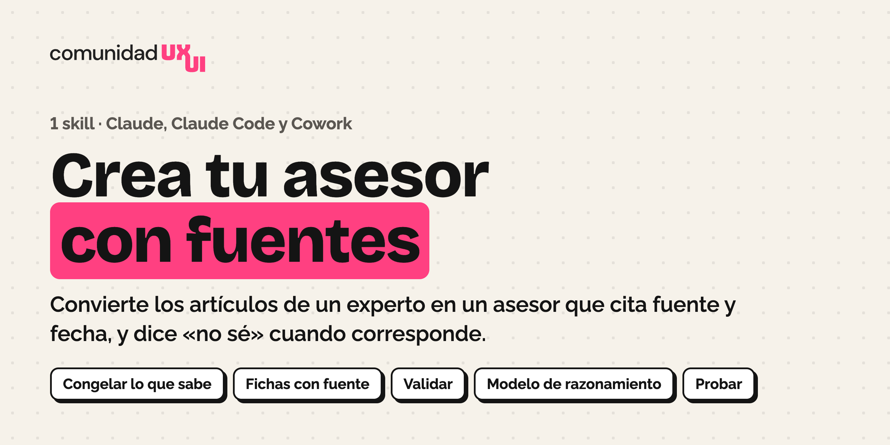
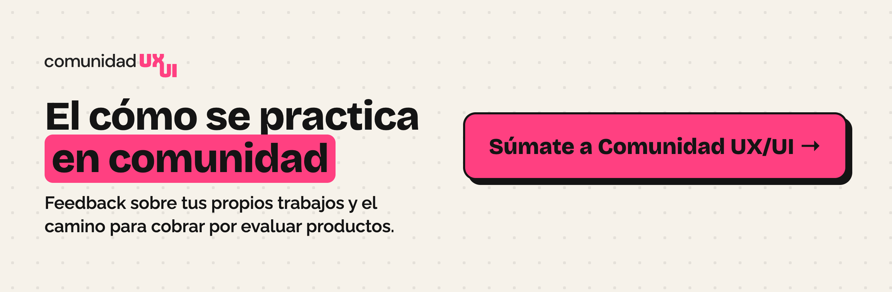

<p align="center"></p>

# Crea tu asesor con fuentes

**Convierte los artículos, videos o libros de un experto en un asesor que responde citando la fuente y la fecha de cada afirmación, y que dice «no sé» cuando el material no cubre tu pregunta.**

[](LICENSE)
[](skills/)
[](#en-claude-code)
[](#)

---

## Qué resuelve

Si le dices a una IA «actúa como Jakob Nielsen», te responde el Nielsen de las 10 heurísticas de 1994: lo que más circula en internet. Un asesor armado con este método responde con lo que el autor dice en sus fuentes, separa lo citado de lo que extrapola y registra cuándo el autor cambió de opinión.

Sirve para cualquier experto del que tengas fuentes confiables: una autora de research, tu contadora, un abogado, un libro de referencia.

## Cómo funciona

1. **Congela lo que la IA ya cree saber del autor**, antes de leer nada, para que no se mezcle con el material.
2. **Destila el material en fichas**, cada una con fuente, ubicación y fecha, y citas de 25 palabras como máximo.
3. **Valida las fichas con un script**: si una cita se pasa del tope o falta una fuente, la ficha no entra.
4. **Sintetiza cómo razona el autor**: qué exige saber antes de opinar, en qué orden descarta, qué se niega a responder.
5. **Arma el asesor** con la [plantilla incluida](skills/crea-tu-asesor/plantilla-asesor.md) y lo prueba con tus preguntas reales.

Cada respuesta del asesor termina con sus fuentes (`ficha · archivo:línea · fecha`) y separa en un bloque aparte lo extrapolado.

## Míralo armado en vivo

En este vivo armamos un asesor de Jakob Nielsen con sus artículos de UX Tigers, de principio a fin: **[Ten a Jakob Nielsen 24/7 para tus dudas de UX](https://youtu.be/-nYZwgQvmio)** (2 h).

## Cómo se usa

Pídele: *«Quiero un asesor de [autor]. Tengo estos artículos.»* La skill te pide las fuentes y entre 3 y 5 preguntas reales de tu trabajo, que sirven para probar el asesor al final.

- **En Claude Code** corre el método completo, con validador y pruebas.
- **En claude.ai o NotebookLM** hace la versión liviana: un Proyecto con las fichas y las reglas del asesor en las instrucciones.

## Instalación

### En claude.ai y en Cowork

1. Descarga `crea-tu-asesor.zip` desde **[Releases](https://github.com/CUXUI/crea-tu-asesor/releases/latest)**.
2. En Claude, entra a **Personalizar → Skills → + → Subir una skill** y súbelo tal como lo descargaste.
3. Abre un chat nuevo y pide lo que necesitas.

Guía paso a paso con capturas: **[cómo subir una skill a claude.ai](NOTION_LINK)**.

### En Claude Code

```
/plugin marketplace add CUXUI/crea-tu-asesor
/plugin install crea-tu-asesor@crea-tu-asesor
```

Después pide lo que necesitas o llama la skill directo: `/crea-tu-asesor`.

### En Codex, Cursor, Gemini CLI y otros agentes

```bash
npx skills add CUXUI/crea-tu-asesor
```

Necesita Node.js 22.20 o superior. Si tu agente no instala skills, deja el repositorio en tu carpeta de trabajo y pídele que lea el `SKILL.md` de la carpeta `skills/` y lo siga.

## Qué hay adentro

```
skills/crea-tu-asesor/
├── SKILL.md              el método completo, paso a paso
└── plantilla-asesor.md   el asesor final, listo para completar con el nombre del autor
```

## Límites honestos

- **La base que armes es de uso personal.** El material del autor no se publica ni se redistribuye: la base guarda análisis propio y citas cortas con su fuente.
- **Es un proyecto de varias horas**, no un prompt. La versión liviana en claude.ai es más rápida y menos rigurosa.
- **Si el material no cubre tu pregunta, el asesor te lo dice.** Es parte del método, no una falla.
---

## Criterio con fuentes

Consultar a un referente es el primer paso. Aplicar ese criterio a productos reales y defenderlo frente a un cliente es lo que practicamos en **[Comunidad UX/UI](https://www.skool.com/comunidaduxui/about)**.

<p align="center"><a href="https://www.skool.com/comunidaduxui/about"></a></p>

¿Prefieres empezar por correo? Suscríbete a **[Minuto UX](https://comunidad-uxui.kit.com/fb40f8e711)**, el newsletter de Comunidad UX/UI.

<p align="center"><a href="https://comunidad-uxui.kit.com/fb40f8e711"></a></p>


## Licencia

[CC BY-NC-SA 4.0](LICENSE). Puedes usarla, adaptarla y compartirla citando a Comunidad UX/UI, sin uso comercial y con la misma licencia.
